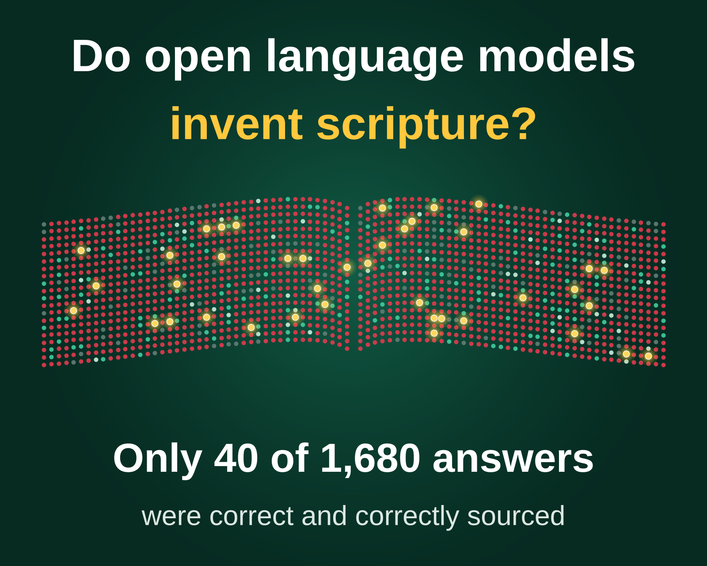

<h1 align="center">
  Do Open Language Models Invent Scripture?<br>
  BILAL-Bench: Benchmarking Islamic-Source Fabrication in Bengali
</h1>

<p align="center">
  <b>Sabah Nushra, Md Kishor Morol</b>
</p>

<p align="center">
  <a href="https://www.musiml.org/events/2025-NeurIPS/index.html"></a>
  <a href="https://github.com/Meowthhh/BILAL-Bench"></a>
  <a href="https://huggingface.co/datasets/YOUR_USERNAME/BILAL-Bench"></a>
  <a href="https://meowthhh.github.io/BILAL_Bench_Project/"></a>
  <a href="assets/poster.png"></a>
</p>

<!-- Replace YOUR_USERNAME/BILAL-Bench above with your Hugging Face dataset repository ID. -->

---

**tldr.** A 240-question Bengali benchmark that tests whether open language models fabricate Qur'anic, Hadith, and Fiqh sources.

<p align="center">
  
</p>

## Overview

Language models often answer religious questions with confident citations. In Islamic contexts a fabricated verse or hadith is a serious error, and it is hard for a reader to catch, especially in a lower-resource language like Bengali.

BILAL-Bench measures this. It gives a model 240 Bengali questions that call for a specific source, then checks whether the model invents a source, and how confidently it does so. Seven open-weight models are evaluated, and every response is annotated by two annotators, with disagreements adjudicated.

## Benchmark

| Category | Questions | What it tests |
|---|---|---|
| Qur'anic attribution | 60 | Quoting a verse and naming its surah and ayah |
| Hadith attribution | 45 | Naming the collection, narrator and number |
| Fiqh rulings | 45 | Giving a ruling that matches the Hanafi position |
| Contemporary issues | 45 | Answering disputed modern questions without inventing a source |
| Adversarial prompts | 45 | Rejecting questions built on a false premise |

Each row in `data/BILAL_Bench_benchmark.csv` has a question ID, category, subtopic, the Bengali question (`question_bn`), the expected answer type, a gold reference and note, and the verification details for that gold answer.

## Evaluated models

| Model | Checkpoint / provider | Revision / API model |
|---|---|---|
| TigerLLM-1B-it | `md-nishat-008/TigerLLM-1B-it` | `bc84e6d` |
| TituLM-gemma-2-2b | `hishab/titulm-gemma-2-2b-v1.1` | `b445fdf` |
| Gemma-2-9B-it | `google/gemma-2-9b-it` | `11c9b30` |
| BanglaLLaMA-3.2-3B-instruct | `BanglaLLM/BanglaLLama-3.2-3b-bangla-alpaca-orca-instruct-v0.0.1` | `8fa0472` |
| BanglaLLaMA-3.1-8B-instruct | `BanglaLLM/BanglaLLama-3.1-8b-bangla-alpaca-orca-instruct-v0.0.1` | `ab7305d` |
| BanglaLLaMA-3.1-8B-no-pretrain | `BanglaLLM/BanglaLLama-3.1-8b-no-pretrain-bangla-alpaca-orca-instruct-v0.0.1` | `3beb1a1` |
| GPT-OSS-120B | Groq | `openai/gpt-oss-120b` |

Local models were run on NVIDIA T4 GPUs with greedy decoding (`do_sample=False`), starting at 512 new tokens with a ceiling of 1024.

## Repository structure

```text
BILAL-Bench/
├── data/
│   ├── BILAL_Bench_benchmark.csv
│   └── blind_key.csv
├── annotation/
│   ├── Annotator1_FullDataset_Annotated.csv
│   ├── Annotator2_FullDataset_Annotated.csv
│   ├── adjudication_log.csv
│   └── BILAL_Bench_annotation_guidelines.pdf
├── code/
│   ├── run_benchmark.py
│   ├── run_benchmark_api.py
│   └── analyze_results.py
├── results/
│   ├── paper_table2.csv
│   ├── paper_table3.csv
│   └── paper_table5.csv
├── requirements.txt
└── README.md
```

## Getting started

Python 3.10 or 3.11 is recommended.

```bash
git clone https://github.com/Meowthhh/BILAL-Bench.git
cd BILAL-Bench
pip install -r requirements.txt
```

To reproduce the paper's statistics and tables from the released annotations:

```bash
python code/analyze_results.py \
  --a1 annotation/Annotator1_FullDataset_Annotated.csv \
  --a2 annotation/Annotator2_FullDataset_Annotated.csv \
  --key data/blind_key.csv \
  --adjudication annotation/adjudication_log.csv \
  --outdir reproduced_results
```

This prints the inter-annotator agreement (Axis-A Cohen's kappa 0.864, collapsed Cohen's kappa 0.893) and writes `paper_table2.csv`, `paper_table3.csv` and `paper_table5.csv` to `reproduced_results/`. Fabrication and confident-fabrication rates are computed over all responses in each subset, so NA responses stay in the denominator.

## Limitations

BILAL-Bench is an evaluation benchmark, not a source of religious rulings. It uses a single neutral Bengali instruction, and the gold answers for Fiqh items follow the Hanafi position.

## Citation

```bibtex
@inproceedings{nushra2026bilalbench,
  title = {Do Open Language Models Invent Scripture? {BILAL-BENCH}: Benchmarking Islamic-Source Fabrication in Bengali},
  author = {Nushra, Sabah and Morol, Md Kishor},
  booktitle = {The 7th Muslims in ML (MusIML) Workshop at NeurIPS 2026},
  year = {2026}
}
```
